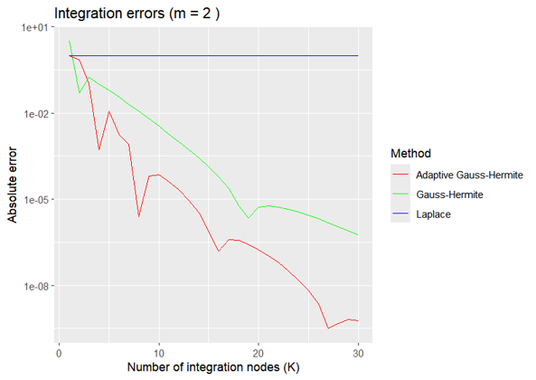

```{r}
#| include: false
library(here)
group <- 5
source(here("raw_data", "group_data.R"))
gp <- group_data(group)
```

GenAI declaration, README and final render check - (D or E, to be agreed)

# Part A

gauss_hermite(n):produces Gauss–Hermite nodes and weights for weight function e−x2, by the Golub–Welsch method. gh(theta, cd, K): non-adaptive numerical integral based on Gauss-Hermite. cluster_integral(theta, cd, j): calculates the true marginal likelihood of a cluster cluster_data(y, X, group): prepares and validates the data before calculating the marginal log-likelihood rint_sim(J, m, beta, sigma): simulate data according to the model with one standard-normal covariate

# Table of tests

ROLE E

# Part B

## B1 - How many nodes - ROLE A (5)

  Gauss-Hermite (GH) and Adaptive Gauss-Hermite (AGH) generally improve as the number of integration nodes (K) increases. Laplace does not use integration nodes, but rather the mode and curvature so its error does not change for different values of K.

Every additional observation (m) adds another log-likelihood contribution to hj(u). This generally makes the function more concentrated around its mode. This negatively impacted the accuracy of GH, which places its nodes according to the normal weighting function (centred at zero). Therefore, it performed better when m=2. Whereas, AGH adjusts the location and scale of its nodes to the integrand, using its mode and local curvature. This meant AGH performed the best in both cases. It converges faster when m=2 and significantly outdid the other 2 methods when m=20. Laplace performed poorly overall, as its Gaussian approximation does not capture the shape of the integrand well.

## B2 - Importance Sampling - Roles below (5)

(C) 

- For the m=20 data set, estimate ℓ by importance sampling with R = 10, 30, 100, 300 and 1000 draws, repeating each 200 times with fresh draws.

- **Plot** the bias and standard deviation of the estimates against R, and compare the standard deviation with your package’s own Monte Carlo SE.

- Explain why the estimate of ℓ=∑jlogLj is biased even though each estimate of Lj is unbiased, and how the bias depends on R **\[at most 100 words\].**

(D) 

- Then show what goes wrong if `fit_rint()` draws fresh importance-sampling draws at every evaluation of ℓ.

## B3 - Cost - Role B (5)

- **Time** one evaluation of ℓ by each method with `system.time()`, repeating it enough times to give stable timings, for J = 50, 200 and 800 clusters of size 5.

- Compare your vectorised `cluster_modes()` with a version that calls `optimize()` once per cluster, and report the speed-up.

- Which method would you use inside an optimiser that needs hundreds of evaluations, and why **\[at most 100 words\]?**

# Part C (25)

Compare the four methods as ways of **fitting** the model, using `"agh"` with 7 nodes, `"gh"` with 10 nodes and `"is"` with 100 draws, alongside `"laplace"`. Follow the design and reporting guidance from Lecture 8.

## C1 - Design - Roles below (6)

- Write the study’s ADEMP \[at most 200 words\].

Aims: Compare the four methods as ways of fitting the model by analysing the performance measures detailed below. Data-generating mechanisms: Simulating the data using rint_sim() with parameters J=50, $\beta$ = (-0.5,1), m = 2, 5 and 20 and $\sigma$ = 0.5 and 1.5. Estimands:$\beta_0$, $\beta_1$ and $\sigma$.

(C: methods, performance measures, failed fits)

- Use J=50 clusters, β=(−0.5,1), cluster sizes m = 2, 5 and 20, and σ = 0.5 and 1.5. Your estimands must include β1 and σ, and your performance measures must include bias, empirical standard error, and the coverage of nominal 95% Wald intervals (for σ, built on the logσ scale and back-transformed). Record how often each fit fails to converge, and say how you will handle such fits.

## C2 - Number of replicates - Role D (4)

Choose the number of replicates so that the Monte Carlo standard error of each coverage is at most 1 percentage point, and that of each bias is small enough to detect the differences you care about. **Show the calculation, using a pilot run if you need one.**

## C3 - Results - Role D (8)

Run the study and present the results in tables and figures, with every performance measure given with its Monte Carlo standard error. Report the time each method took.

## C4 - Recommendations - Roles below (7)

Which method would you recommend, for which cluster sizes and amounts of between-cluster variation? Explain the behaviour you see from how each method approximates Lj, linking it to your results in Part B \[at most 300 words\].

(A) 

- Behaviour of Gauss-Hermite, from how it approximates Lj, linked to B1.

(B) 

- Behaviour of Laplace and adaptive Gauss-Hermite, from how they approximate Lj, linked to B1 and B3.

(C) 

- Behaviour of importance sampling, from how it approximates Lj, linked to B2.

(E) 

- The recommendation itself: which method, for which cluster sizes and amounts of between-cluster variation (also needed for D1).

# Part D (10 marks)

## D1 - Analysis - Role E (5 marks)

Fit the model `attended ~ age` with a random intercept for `practice` by the method your study recommends for data like these, and by the other three. Report the estimates with 95% confidence intervals, and interpret the effect of age as an odds ratio and σ in context: for example, compare the predicted attendance probability for a patient of average age at a practice one standard deviation above and below average \[at most 150 words\].

## D2 - Do the practices matter? - Role E(5 marks)

Compare the random-intercept model with a pooled logistic regression, `glm(attended ~ age, family = binomial)`, by 5-fold cross-validation in which each fold holds out **whole practices** (Lecture 11). Score each model by the log-likelihood of the held-out practices’ responses: for the random-intercept model, that is ∑jlogLj over the held-out practices, at the parameters fitted to the other folds. Report both cross-validated scores with their standard errors across folds. Explain why holding out random patients instead would be wrong here \[at most 100 words\].
